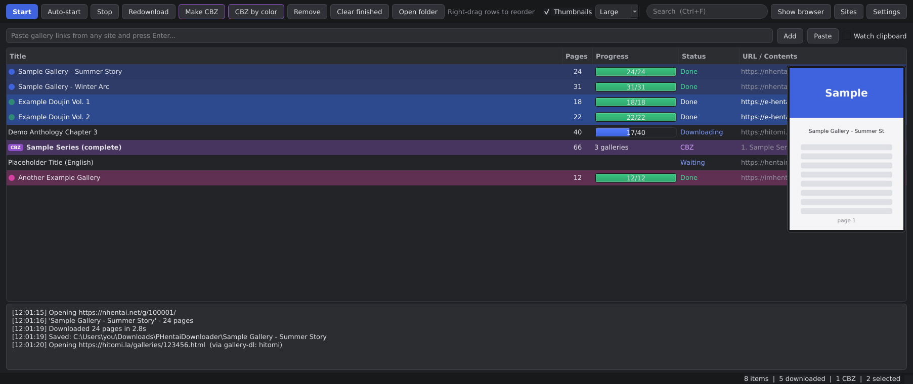
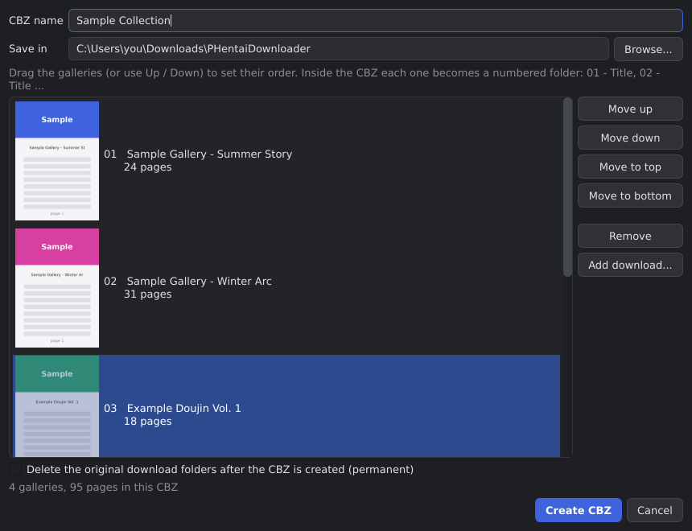
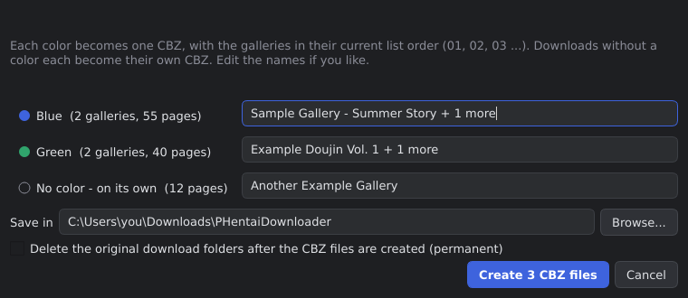
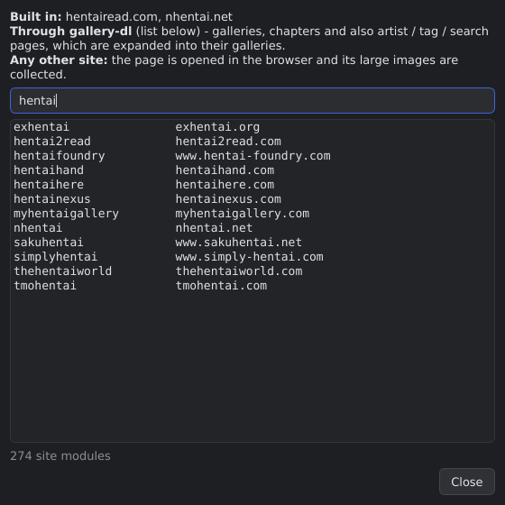

# PHentai Downloader

**A fast, dark-themed Windows downloader for doujinshi and manga galleries, with a built-in CBZ organiser.**
Paste gallery links, press **Start**, and get clean numbered image folders. Then combine,
reorder and edit them as CBZ files without leaving the app.

> **Adults only (18+).** This tool downloads adult content. Respect each site's terms of
> service and the laws of your country.



---

## Features

**Downloading**
- **Many sites:** built-in support for **hentairead.com** and **nhentai.net**, about
  **270 more** through [gallery-dl](https://github.com/mikf/gallery-dl) (e-hentai/exhentai,
  hitomi, hentai2read, hentainexus, imhentai, simply-hentai, 8muses, luscious, mangadex, ...),
  and a **generic mode** that collects the large images from any other page.
- Artist, tag and search pages are expanded into separate gallery downloads.
- **Fast:** pages download in parallel (8 at a time by default), and unfinished galleries
  resume where they stopped.
- **Full quality:** the original images, not the thumbnails.
- **Redownload** (Ctrl+R) a gallery to replace its files.
- **Auto-start:** new links start downloading as soon as they are added.

**Organising**
- **CBZ maker:** combine downloads into one CBZ. Each gallery becomes a numbered folder
  (`01 - Title`, `02 - Title`, ...). Arrange them with page-1 previews, add or remove
  galleries, and **edit a CBZ later**.
- **CBZ by color:** colour-label your downloads and make **one CBZ per color** in one
  click. Downloads without a color each get their own CBZ.
- **Color labels** (Ctrl+1 to Ctrl+9), **right-drag to reorder**, multi-select,
  **search** (Ctrl+F) and **duplicate detection**.
- **Hover thumbnails** (Small to Huge) that always stay on screen.
- **Drag rows to Windows Explorer** to move the folders or CBZ files.
- **Clipboard watcher:** copy a gallery link anywhere and it is added automatically.
- File names stay within Windows' path-length limit.

| Arrange a CBZ | One CBZ per color |
|---|---|
|  |  |

<p align="center"></p>

---

## How to run

### Option 1: Build the .exe (recommended)

1. Install **Python 3.10 or newer** from <https://www.python.org/downloads/>.
   During setup, tick **"Add python.exe to PATH"**.
2. Download this repository: **Code → Download ZIP**, then unzip it.
3. Double-click **`build.bat`**. The first build takes a few minutes because it installs
   the libraries.
4. Your program is at **`dist\PHentaiDownloader4.exe`**. Copy it anywhere you like and
   create a shortcut.

### Option 2: Run from source (no build)

Do steps 1 and 2 above, then double-click **`run.bat`**.

Or, from a terminal:

```bat
pip install -r requirements.txt
python phentai_downloader.py
```

**Requirements:** Windows 10 or 11, plus **Microsoft Edge** (pre-installed on Windows) or
Google Chrome. The app uses your installed browser for sites that need it.

---

## Quick start

1. Click **Settings** and choose your **Download folder**.
2. Paste one or more gallery links into the box and press **Enter**. You can also click
   **Paste** (Ctrl+V), drag links into the list, or tick **Watch clipboard**.
3. Press **Start**, or switch on **Auto-start**.
4. **Double-click** a finished row to open its folder.
5. To make a CBZ: select downloads, then right-click → **Add to CBZ...** (Ctrl+B), or use
   **CBZ by color** (Ctrl+Shift+B).

### Keyboard shortcuts

| Keys | Action |
|---|---|
| Ctrl+V | Paste links |
| Ctrl+F / Esc | Search / clear search |
| Ctrl+B | Make CBZ from the selection |
| Ctrl+Shift+B | One CBZ per color |
| Ctrl+R | Redownload |
| Ctrl+1 to Ctrl+9 / Ctrl+0 | Set color / remove color |
| Del | Remove from the list |
| Enter or double-click | Open the folder |
| Right-drag | Reorder rows |

---

## About Cloudflare checks

Some sites show a Cloudflare **"Verify you are human"** page. When that happens, the app
brings the Edge window on screen so **you** can click the check, then continues by itself.
The app never clicks or solves checks for you.

Some sites are set to reject any browser that is controlled by a program, even after a
person clicks the check. Those sites can't be downloaded automatically. In that case, use
another supported site for the same gallery.

---

## Where your data is stored

| What | Where |
|---|---|
| List, colors, settings, log | `%APPDATA%\PHentaiDownloader4\` |
| The app's private browser profile | `%APPDATA%\PHentaiDownloader4\browser-profile\` |
| Downloads and CBZ files | The folder chosen in **Settings** |

Problems? The log is at `%APPDATA%\PHentaiDownloader4\log.txt`. Please attach it when you
open an issue.

---

## License

[GPL-2.0](LICENSE). See [THIRD_PARTY_NOTICES.md](THIRD_PARTY_NOTICES.md) for the libraries
used and their licenses.
